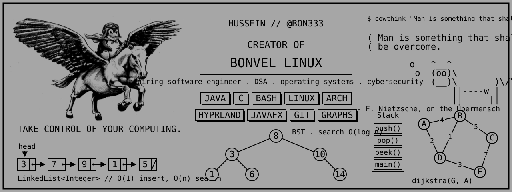
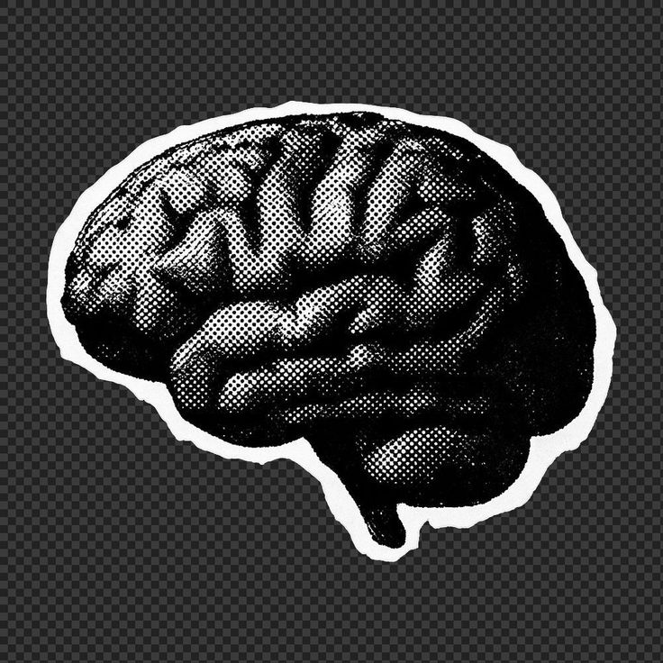

  

<h1 align="center">
  Olá  I'm Hussein
</h1>

### 🔗 Know About Me

<table>
  <tr>
    <td width="30%">
      
    </td>
    <td width="100%">
      <b>Hey there! I'm Hussein</b>  
      Aspiring software engineer with a passion for data structures and algorithms.  
      By day, I'm writing code in <b>Java and C</b> and digging into operating systems and cybersecurity.  
      When I'm not breaking my own Linux setup, I'm teaching <code>cowthink</code> to think my deepest thoughts in ASCII.
        
      <b>⚙️ Tech Stack:</b> 
      
      
      
      
    </td>
  </tr>
</table>

### 🔗 Top Projects (built to avoid manual labor)

<table>
  <tr>
    <td width="80%">
      <ul>
        <li><a href="https://github.com/BON333/BonVel-linux"><b>BONVEL LINUX</b></a> &nbsp; My own Linux setup, because configuring things for hours beats doing anything productive.</li>
         
        <li><a href="https://github.com/BON333/ubermensch"><b>ÜBERMENSCH</b></a> &nbsp; Black and white Hyprland, lightning in the terminal and Nietzsche quotes. God is dead, and so is my free time.</li>
         
        <li><a href="https://github.com/BON333/PassAval"><b>PASSAVAL</b></a> &nbsp; Graph algorithms applied to real life, since real life refused to be a tree.</li>
      </ul>
    </td>
    <td width="20%">
      
    </td>
  </tr>
</table>

### 🔗 Connect

  
  

 

> Code is never finished. It only becomes slightly less terrible over time.  
> Every commit I make is essentially just a small, desperate apology to my future self. Someday I will return to this codebase, look at the spaghetti I've written, and wonder who let me anywhere near a keyboard.

 

### 🔗 Streak

  

### 🔗 Contribution

  

